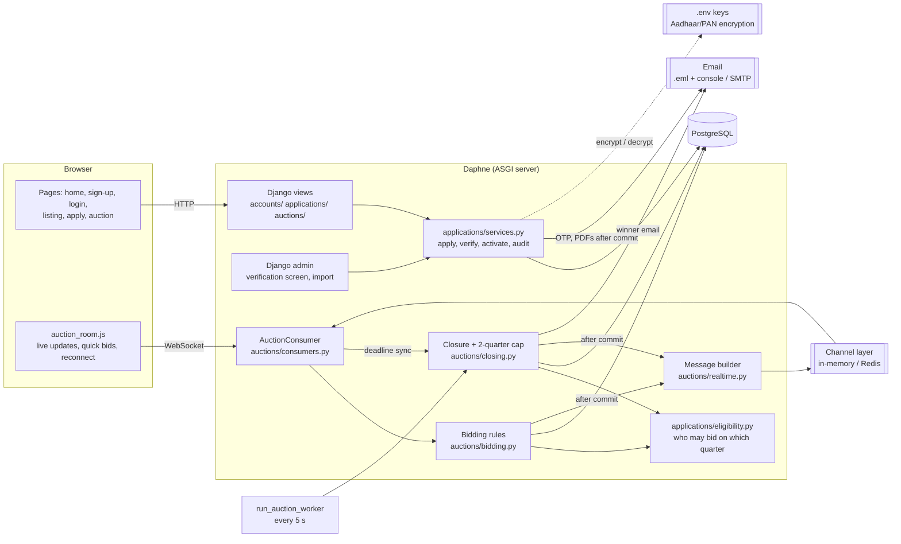
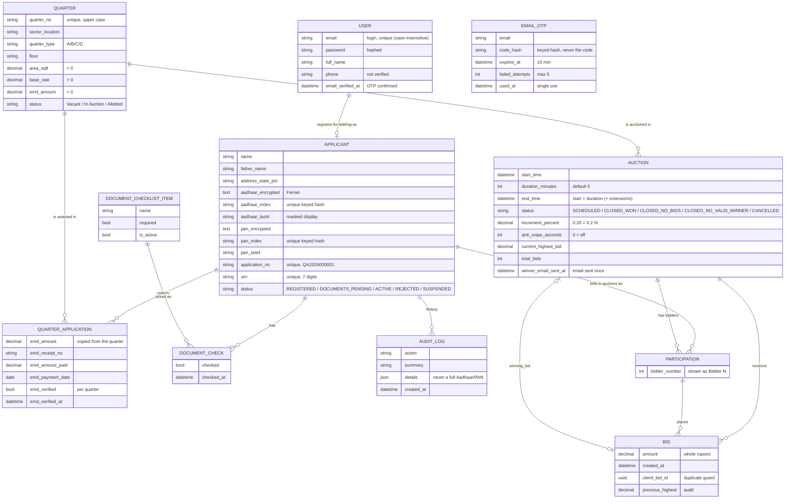
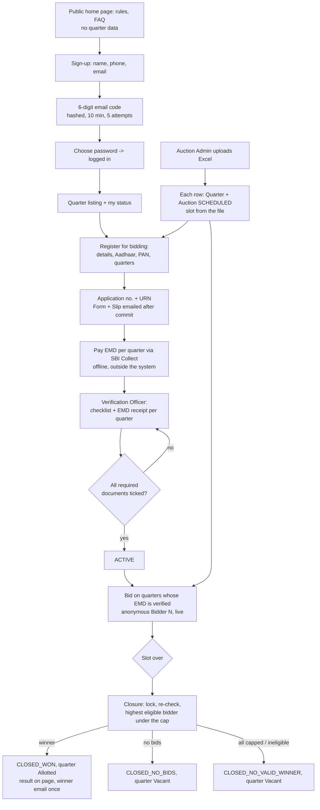

# Architecture

> Training project, not an official SAIL system. Business rules marked "placeholder"
> are assumptions listed in `CLAUDE.md` section 12 and `PROGRESS.md`.
> This describes the workflow of Change Request #3 (`docs/CHANGE_REQUEST_3.md`).

The diagrams use [Mermaid](https://mermaid.js.org/). GitHub and VS Code (with the
"Markdown Preview Mermaid Support" extension) draw them automatically. To export a
picture for a report, paste a diagram into https://mermaid.live.

---

## 1. System architecture



| Part | Role |
|---|---|
| **Daphne** | One server process for both normal pages (HTTP) and live connections (WebSocket). `runserver` uses it automatically. |
| **accounts/** | Custom `User` (email login), sign-up with email OTP (`otp.py`), login, password reset. |
| **applications/** | "Register for bidding", Aadhaar/PAN encryption, URN, PDFs, offline verification, roles, audit log, and `eligibility.py`. |
| **eligibility.py** | The single rule "may this applicant bid on this quarter?" used by the pages, the WebSocket, bidding and closure. |
| **AuctionConsumer** | One per open auction tab. Logged-in users may watch (others are refused with 4401); only an eligible participant's connection may bid. |
| **bidding.py** | *All* bid rules, run inside a transaction holding a row lock on the auction. |
| **closing.py** | Closes finished auctions exactly once, applies the 2-quarter cap, picks the winner. |
| **realtime.py** | Builds every message sent to browsers: anonymous codes, amounts and times only. |
| **Channel layer** | Delivers a message to every tab in an auction's group (`auction_<id>`). In-memory for one process; Redis for several. |
| **Worker** | `manage.py run_auction_worker`: closes due auctions and retries failed emails. |
| **PostgreSQL** | All data. Row locks (`select_for_update`) make simultaneous bids and closures safe. |

---

## 2. Data model (ER diagram)


(EMAIL_OTP stands alone: it is matched to a sign-up by email, before any User exists.
Every staff action also records the acting USER: `status_changed_by`, `emd_verified_by`,
`checked_by`, `AUDIT_LOG.actor`.)

**Key database rules** (enforced by PostgreSQL itself, not only by Python):

| Rule | Constraint |
|---|---|
| Email unique ignoring case | `user_email_unique_ci` |
| One application per Aadhaar / per PAN | unique `aadhaar_index`, `pan_index` |
| One row per applicant per quarter | `one_application_per_quarter` |
| A verified EMD has receipt, date, officer and amount >= EMD | `verified_emd_is_complete` |
| Quarter numbers unique, ignoring case | `quarter_no_unique_ci` |
| Area, base rate, EMD, increment, duration, bid amount > 0 | check constraints |
| Only one SCHEDULED auction per quarter | `one_scheduled_auction_per_quarter` (partial unique) |
| **A quarter can be won only once** | `quarter_won_only_once` (partial unique) |
| "Closed - won" ⇔ has a winning bid | `winning_bid_matches_status` |
| One code per applicant per auction; codes unique per auction | participation unique constraints |
| The same browser submission can't create two bids | `no_duplicate_bid_submission` |
| Two bids in one auction never have the same amount | `unique_bid_amount_per_auction` |

**Privacy:** `PARTICIPATION` is the only link between a person and a "Bidder N" code.
Public pages, bid history, WebSocket messages and ordinary admin screens show codes only;
the Participation admin screen is superusers only. Aadhaar/PAN exist in the database only
as encrypted tokens and keyed hashes; they are displayed masked, and the full value only
through the audited "reveal" action.

---

## 3. Workflow (end to end)



---

## 4. One bid, step by step

```mermaid
sequenceDiagram
    participant A as Bidder A (browser)
    participant C as AuctionConsumer
    participant S as place_bid()
    participant D as PostgreSQL
    participant G as Channel layer
    participant B as Other tabs (bidders + watchers)

    A->>C: {"type":"bid","amount":"45090","client_bid_id":"..."}
    C->>S: place_bid(auction, applicant, amount, id)
    S->>D: BEGIN; SELECT ... FOR UPDATE (auction row)
    Note over S,D: other bids for this auction wait here
    S->>S: live? has code? duplicate? still eligible? >= highest + step? not self-outbid? anti-snipe?
    S->>D: INSERT bid; UPDATE auction; COMMIT
    S-->>G: (after commit) bid_accepted: Bidder 1, 45090, new highest, quick-bid amounts, deadline
    G-->>A: bid_accepted
    G-->>B: bid_accepted
    C-->>A: bid_result ok
```

If any check fails, `place_bid` raises `BidRejected`, the transaction rolls back, and
only the sender receives `bid_result` with the reason.

## 5. Closing two auctions at the same moment (2-quarter cap)

```mermaid
sequenceDiagram
    participant W1 as Closer of auction 1
    participant W2 as Closer of auction 2
    participant D as PostgreSQL

    W1->>D: lock auction 1
    W2->>D: lock auction 2
    W1->>D: lock bidders of auction 1 (id order) incl. applicant X
    W2->>D: lock bidders of auction 2 (id order) incl. X -> WAITS
    W1->>D: X holds 1 quarter < 2 -> X wins auction 1; COMMIT
    D-->>W2: lock on X granted
    W2->>D: X now holds 2 -> skip X; next-highest eligible bidder wins; COMMIT
```
Locking bidders in id order means two closers can never wait for each other in a circle
(no deadlock). `test_concurrency.py` (AllotmentCapConcurrencyTests) gives X three quarters
when the lock is removed, and passes with it.

---

## 6. Why each design choice

| Choice | Reason |
|---|---|
| Custom User with email login, made before the first migration | CR #3 logs in by email. Swapping the user model later is very hard in Django, so the migrations were reset once (dev data only) to do it cleanly. |
| OTP stored as a keyed hash, attempts counted in the database | A database leak doesn't reveal codes; the lock on the OTP row counts simultaneous guesses correctly. |
| Aadhaar/PAN: Fernet + keyed hash + last 4 | Encrypted at rest with keys outside the database (rotation supported); uniqueness without storing the number; masked display needs no decryption. |
| Eligibility in one function | Pages, WebSocket, bidding and closure can never disagree about who may bid. |
| Applicant re-read inside `place_bid` | A suspension or EMD un-verification takes effect even on an already-open WebSocket. |
| Row lock on the **auction** row | Every bid for one auction is processed one at a time, while different auctions don't block each other. Proven by `test_concurrency.py`, which fails if the lock is removed. |
| Bidder rows locked at closure (id order) | Enforces the 2-quarter cap when auctions close simultaneously, without deadlocks. |
| Broadcast and emails **after commit** | Nobody sees a bid that was rolled back; no email for an application that wasn't saved. |
| Phase computed from the clock | No job needs to flip "Upcoming" to "Live"; the page is always right. |
| Closure is idempotent | Several workers, or a worker plus a browser sync, can't award a quarter twice. Also enforced by the `quarter_won_only_once` constraint. |
| `client_bid_id` from the browser | A double-click or a resend after reconnect can't create two bids. |
| Quick bids send an explicit amount | The bidder always pays what the button showed; if someone bid first, the server rejects it as too low and the buttons update. |
| Snapshot on every (re)connect | A tab that lost its connection or slept shows the true current state. |
| All browser messages in `realtime.py` | One file to audit for privacy. |
| Every verification action through `services.py` | One place for the rules and the audit log; the admin screen only calls it. |
| Management-command worker (not Celery) | No extra services. Easy to run and to explain. |
