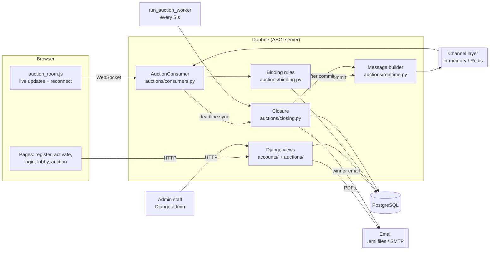
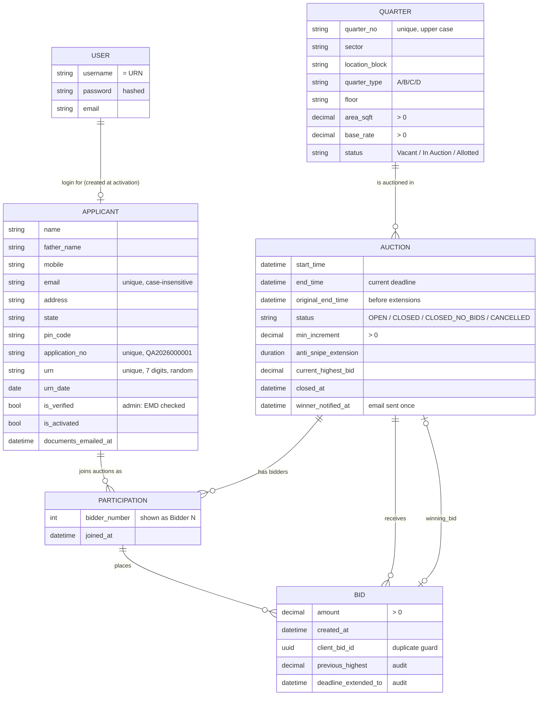
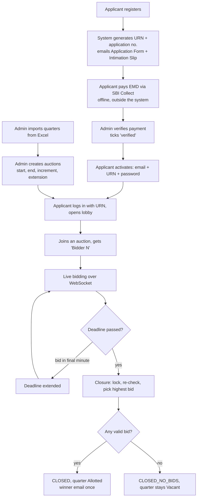

# Architecture

> Training project, not an official SAIL system. Business rules marked "placeholder"
> are assumptions listed in `PROGRESS.md`.

The diagrams use [Mermaid](https://mermaid.js.org/). GitHub and VS Code (with the
"Markdown Preview Mermaid Support" extension) draw them automatically. To export a
picture for a report, paste a diagram into https://mermaid.live.

---

## 1. System architecture



| Part | Role |
|---|---|
| **Daphne** | One server process for both normal pages (HTTP) and live connections (WebSocket). `runserver` uses it automatically. |
| **Django views** | Registration, activation, login, lobby, auction page, admin. |
| **AuctionConsumer** | One per open auction tab. Checks the user may watch that auction, receives bids, pushes updates. |
| **bidding.py** | *All* bid rules, run inside a transaction holding a row lock on the auction. |
| **closing.py** | Closes finished auctions exactly once and picks the winner. |
| **realtime.py** | Builds every message sent to browsers: anonymous codes, amounts and times only. |
| **Channel layer** | Delivers a message to every tab in an auction's group (`auction_<id>`). In-memory for one process; Redis for several. |
| **Worker** | `manage.py run_auction_worker`: closes due auctions and retries failed emails. |
| **PostgreSQL** | All data. Row locks (`select_for_update`) make simultaneous bids safe. |

---

## 2. Data model (ER diagram)



**Key database rules** (enforced by PostgreSQL itself, not only by Python):

| Rule | Constraint |
|---|---|
| Quarter numbers unique, ignoring case | `quarter_no_unique_ci` |
| Area, base rate, increment, bid amount > 0 | check constraints |
| Auction ends after it starts | `auction_end_after_start` |
| Only one OPEN auction per quarter | `one_open_auction_per_quarter` (partial unique) |
| **A quarter can be won only once** | `quarter_won_only_once` (partial unique) |
| "Closed - won" ⇔ has a winning bid | `winning_bid_matches_status` |
| One code per applicant per auction; codes unique per auction | `participation` unique constraints |
| The same browser submission can't create two bids | `no_duplicate_bid_submission` |
| Two bids in one auction never have the same amount | `unique_bid_amount_per_auction` |
| Activated applicant must have a login | `applicant_activated_has_user` |

**Privacy:** `PARTICIPATION` is the only link between a person and a "Bidder N" code.
Public pages, bid history, WebSocket messages and ordinary admin screens show codes only.
The Participation admin screen is visible to superusers only.

---

## 3. Workflow (end to end)



---

## 4. One bid, step by step

```mermaid
sequenceDiagram
    participant A as Bidder A (browser)
    participant C as AuctionConsumer
    participant S as place_bid()
    participant D as PostgreSQL
    participant G as Channel layer
    participant B as Other bidders

    A->>C: {"type":"bid","amount":"4600","client_bid_id":"..."}
    C->>S: place_bid(auction, applicant, amount, id)
    S->>D: BEGIN; SELECT ... FOR UPDATE (auction row)
    Note over S,D: other bids for this auction wait here
    S->>S: live? joined? duplicate? >= minimum? not self-outbid? anti-snipe?
    S->>D: INSERT bid; UPDATE auction; COMMIT
    S-->>G: (after commit) bid_accepted: Bidder 1, 4600, new deadline
    G-->>A: bid_accepted
    G-->>B: bid_accepted
    C-->>A: bid_result ok
```

If any check fails, `place_bid` raises `BidRejected`, the transaction rolls back, and
only the sender receives `bid_result` with the reason.

---

## 5. Why each design choice

| Choice | Reason |
|---|---|
| Row lock on the **auction** row | Every bid for one auction is processed one at a time, while different auctions don't block each other. Proven by `test_concurrency.py`, which fails if the lock is removed. |
| Broadcast **after commit** | Nobody ever sees a bid that was later rolled back. |
| Phase computed from the clock | No job needs to flip "Upcoming" to "Live"; the page is always right. |
| Closure is idempotent | Several workers, or a worker plus a browser sync, can't award a quarter twice. Also enforced by the `quarter_won_only_once` constraint. |
| `client_bid_id` from the browser | A double-click or a resend after reconnect can't create two bids. |
| Snapshot on every (re)connect | A tab that lost its connection or slept shows the true current state. |
| All browser messages in `realtime.py` | One file to audit for privacy. |
| Management-command worker (not Celery) | No extra services. Easy to run and to explain. |
